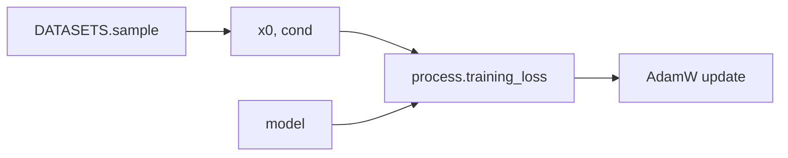
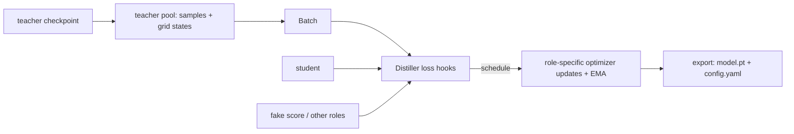
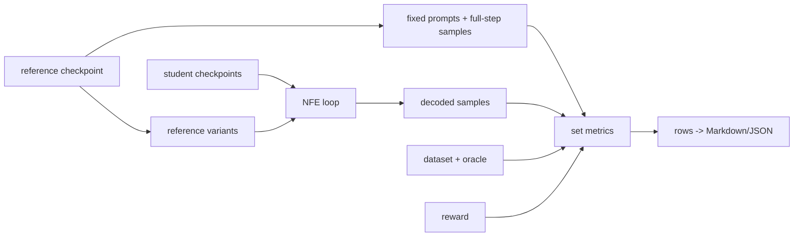

# omnidiff architecture

This document describes the code that is currently in the repository. The
shared unit is a diffusion process: a process owns the state distribution and
its reverse-step policy; models predict the parameters needed by that process.
Training, distillation, inference and evaluation reuse those same objects.

## Package map and dependency direction

`packages/core/src/omnidiff/core` is the foundation. It contains processes,
modality adapters, the DiT model, conditioning, sampling, codecs, prompt
sources, configuration, registries, checkpoint utilities and the base CLI. It
depends only on PyTorch, NumPy and PyYAML. The other packages depend on it:

```text
                         omnidiff-core
                       /       |       \
             omnidiff-data  omnidiff-reward  omnidiff-posttrain
                    \              /             /
                         omnidiff-distill
```

- `omnidiff-data` owns `DATASETS` implementations. A dataset supplies
  `sample(n, rng) -> (x0, cond)`; the shipped datasets are synthetic blobs,
  moving blobs and toy text lines (`packages/data/src/omnidiff/data/datasets.py`).
- `omnidiff-reward` owns decoded-sample rewards, NumPy sample-set metrics and
  the checkpoint scorecard (`reward/rewards.py`, `metrics.py`, `scorecard.py`).
  It depends on core and data, but does not train models.
- `omnidiff-posttrain` owns supervised denoising training and online RL.
  `SFTTrainer` calls a process's `training_loss`; `RLTrainer` runs trajectories,
  scores decoded samples, and applies GRPO or DDPO (`posttrain/sft.py`,
  `posttrain/rl/trainer.py`).
- `omnidiff-distill` owns the multi-role distillation trainer and registered
  methods. It uses core models/processes/sampling plus data and reward metrics
  (`distill/trainer.py`, `distill/methods/`).

The packages are separate distributions under the shared `omnidiff` namespace.
Their `pyproject.toml` files declare `omnidiff.plugins` entry points; posttrain,
distill and reward also declare `omnidiff.commands` entry points.

## Core abstractions

### Processes and exact policy steps

`DiffusionProcess` in `core/processes/base.py` defines `timesteps`, `prior`,
`training_loss`, `transition` and `kl`. Time runs from 1 (noise or fully masked)
to 0 (data). `transition(pred, x_t, t, t_next, x_next=None)` is both the
sampler step and the policy scorer: without `x_next` it draws an action; with a
stored `x_next` it returns that action's exact log-probability. The returned
`Transition` contains `x_next`, a per-sample `log_prob` (or `None` for a
deterministic step), and distribution statistics used by `kl`.

`ContinuousProcess` supplies `q_sample`, `to_x0`, `to_eps`, `ode_step` and
`renoise_transition`. Its generic renoise policy predicts `x0`, then samples
`N(alpha(t_next) x0_hat, sigma(t_next)^2 I)`. `GaussianDiffusion` implements VP
linear/cosine schedules and epsilon prediction; `ddim` is ancestral when
`eta > 0`, `ode` is deterministic, and `renoise` is the few-step policy
(`core/processes/gaussian.py`). `FlowMatching` implements
`x_t=(1-t)x0+t noise` and velocity prediction. Its `sde` transition is the
marginal-preserving Gaussian reverse SDE, `ode` is Euler, and `renoise` uses
the continuous helper (`core/processes/flow.py`).

`MaskedDiffusion` is an absorbing discrete process (`masked.py`). A reverse
step unmasks a masked position with probability `(t-t_next)/t` and samples its
clean token from model logits; already decoded tokens are carried forward. Its
log-prob includes both categorical and unmask/stay Bernoulli terms. `prefix`
positions are fixed. The optional `coupled` sampler draws unmask times and
Gumbel or inverse-CDF uniform noise once, making the ancestral law a
deterministic function of trajectory noise.

### Model contract

The default `Denoiser` (`core/nn/denoiser.py`) is adapter -> backbone -> adapter:
the input adapter maps native data to `(B, N, D)` tokens, the backbone consumes
tokens and a `(B, D)` condition vector, and the adapter head maps back to image,
video or token output. `TokenAdapter`, `ImagePatchAdapter` and
`VideoPatchAdapter` live in `nn/adapters.py`; `DiT` is the default adaLN-Zero
backbone (`nn/backbones.py`).

The callable model contract is `forward(x, t, cond, drop_cond, s=None)` and an
output in the process's prediction parameterisation. `Denoiser.features` exposes
backbone features for auxiliary heads. `Conditioner` modules turn the `cond`
dict into the vector added to the timestep embedding. The built-ins are null,
class-label and precomputed-vector conditioners (`nn/conditioners.py`). A
conditioner advertises `supports_guidance`; `drop_cond` selects its null value.

`two_time=True` adds an `s` embedding for models that predict a jump from `t`
to `s`, used by flow maps. Its output layer is zero-initialised, so loading
one-time weights leaves the two-time model initially equivalent to the original.
`time_scale` controls both timestep embeddings; the default is 1000, while
flow-map teachers use a smaller scale when time derivatives must be smooth.
LoRA wrapping and disabling/merging are in `nn/lora.py`.

`sampling.predict` applies classifier-free guidance by concatenating conditional
and dropped-condition batches and calling `process.guide`. `sampling.step`
passes `s=0` for a renoise sampler and `s=t_next` for an ODE/two-time jump.
`sampling.sample` validates an explicit descending grid, starts at `prior`, and
iterates `step`. With `keep_trajectory=True` it returns `Trajectory`:
`xs` has the prior plus every state, `log_probs` has one value per transition,
`stochastic` marks steps with a defined log-probability, and `timesteps` stores
the grid (`core/sampling.py`).

`Pipeline` (`core/pipeline.py`) builds components from config or a checkpoint,
loads weights, encodes prompts, samples, and decodes outputs. `Generation`
contains decoded samples, prompts, raw process-space tensors and optionally the
trajectory.

### Codecs, prompts, registries and plugins

Codecs isolate user data from process tensors (`core/codecs.py`). `PixelCodec`
maps NumPy `[0,1]` images/videos to tensors `[-1,1]`; `TextCodec` uses a fixed
length byte tokenizer with EOS padding and MASK. A VAE or other latent model
fits the same `encode`/`decode` boundary. Prompt sources implement
`sample(n, rng)` and `encode(prompts, device)`: unconditional, class and text
prefix prompts are in `core/prompts.py`.

`core/registry.py` defines registries for models, adapters, backbones,
conditioners, processes, codecs, datasets, prompts, rewards, algorithms,
distillers and metrics. A spec is a string or `{type: name, ...kwargs}`; a
`pkg.module:Name` type bypasses registration. `Registry.build` injects shared
context only when the constructor asks for it, and explicit spec fields win.
`core/build.py` assembles codec, process, model and prompts, offering
`sample_shape`, `codec`, `mask_id` and `vocab_size` as context.

`discover_plugins()` loads installed `omnidiff.plugins` entry points, while
config `plugins:` imports additional modules. The base CLI loads
`omnidiff.commands` entry points, each of which receives the subparser and
returns a `register(sub)`-installed command. Core provides `sample` and `list`;
the other packages add `sft`, `rl`, `distill` and `scorecard`.

## Training, distillation and evaluation flows

SFT samples `x0, cond` from a dataset, applies process-specific corruption and
loss, then updates the model (`posttrain/sft.py`).



RL groups sampled prompts, rolls out trajectories with the current policy,
decodes final samples for a registered reward, normalizes advantages, and
rescales each stochastic transition with the PPO-style ratio. Optional exact
per-step KL compares the new transition with a frozen copy or LoRA-disabled
base (`posttrain/rl/trainer.py`, `rl/algorithms.py`).

```mermaid
flowchart LR
  PR[prompts + cond] --> R[rollout: sample -> Trajectory]
  R --> RW[codec.decode + reward]
  RW --> A[advantages by prompt group/batch]
  A --> L[step rescoring with stored x_next]
  R --> L
  L --> Q[ratio exp(logp - old_logp) + optional KL]
  Q --> U[optimizer update]
```

Distillation loads a teacher checkpoint, builds a frozen teacher and a student
from the teacher spec, then chooses a teacher sampler, student sampler and
student timestep grid. `TeacherPool` can generate deterministic teacher states
on the grid; `DatasetSource` can instead sample a dataset. The method schedule
drives role updates. Export writes an ordinary checkpoint with the student
model, sampler, explicit grid and `distilled_from` metadata.



The scorecard fixes prompts, generates a full-step reference, evaluates the
reference and each checkpoint at requested NFE values, and records diversity,
teacher/data FD and precision/recall, dataset oracles, rewards and latency.
Continuous references default to ODE; variants can override sampler, shift or
temperature (`reward/scorecard.py`).



## DistillTrainer roles and hooks

`DistillTrainer` has a frozen `teacher`, a trainable `student`, and named
auxiliary roles. `add_role(name, module, lr, betas, ema_decay)` creates an
independent optimizer and optional EMA. Before each update, only the selected
role's parameters require gradients; other roles are frozen, but gradients may
still pass through them to the selected role's inputs. `schedule(it, tr)` can
therefore express DMD2's `fake` updates followed by a `student` update.

`Distiller` in `methods/base.py` provides the method hooks: class attributes
`processes`, sampler defaults, `two_time` and acceptable new parameter prefixes;
`student_spec` customizes the student model, `setup` adds roles/state,
`default_grid` chooses the grid, `schedule` chooses roles, `loss(role, tr)`
returns `(loss, metrics)`, and `after_update` updates method state. Shared
helpers include `teacher_pred`, `student_pred`, `prompt_cond`,
`student_rollout`, and `tr.data.batch`. `eval_student` swaps in the student EMA;
`export` merges LoRA and stores the student sampler/grid.

## Configs and checkpoints

YAML configs put shared construction at the top level: `sample_shape`, `codec`,
`process`, `model`, `prompts`, `sampling`, `device`, `seed`, `output_dir`, and
optional package sections `sft`, `rl` or `distill`. Component sections use
registry specs. `core/config.py` applies dotted overrides such as
`rl.lr=1e-4`, parsing YAML values including floats, lists and nulls.

Training writes, by default, `runs/<name>/sft/{step_N,final}` or
`runs/<name>/rl/{epoch_N,final}`. Distillation writes
`runs/<name>/distill/{step_N,final}`. Each checkpoint directory contains
`model.pt` and `config.yaml`; trainers also write `log.jsonl` beside the
checkpoint directories. `Pipeline.from_checkpoint` rebuilds from
`config.yaml` and loads `model.pt`. Distillation's exported config replaces the
student model, sets `process.sampler`, writes the explicit `sampling.timesteps`
grid and records teacher/method/guidance provenance.

## Extension recipes

- **Process:** subclass `DiffusionProcess` (or `ContinuousProcess`), implement
  its abstract methods and register it in `core/processes/<name>.py` under
  `PROCESSES`; add exact transition/`kl` tests like `test_processes.py`.
- **Model:** implement the model contract, or supply an adapter/backbone/
  conditioner, register it in `core/nn/` and select it in `model`. Context is
  injected by constructor names. See `Denoiser` and `examples/custom_plugin.py`.
- **Reward:** implement `__call__(decoded_samples, prompts) -> np.ndarray(B,)`,
  register under `REWARDS`, and load it through `plugins:` or an entry point.
- **Distiller:** subclass and register `Distiller`, declare supported processes
  and sampler, implement `loss`; add `setup`, `schedule`, `after_update` or
  `student_spec` only when needed. See `methods/dmd2.py` and `methods/base.py`.
- **CLI command:** expose `register(sub)` from a package module and declare an
  `omnidiff.commands` entry point in that package's `pyproject.toml`; use
  `add_config_command` for standard YAML commands.

## Test-enforced invariants

The tests pin the contracts that the architecture relies on:

- Registry context injection, explicit-field precedence, import paths and YAML
  dotted overrides: `test_registry_build_context_and_dotted_paths`,
  `test_config_overrides_and_floats`.
- Patchify/unpatchify round trips, text codec round trip and exact LoRA merge:
  `test_patchify_roundtrip`, `test_text_codec_roundtrip`,
  `test_lora_is_noop_at_init_and_merges_exactly`.
- Gaussian/flow parameterisation and ODE conversions:
  `test_parameterisation_roundtrip`, `test_ode_step_matches_existing_samplers`,
  `test_flow_ode_step_is_euler`.
- Continuous transition log-probs rescore stored actions exactly, KL(new,new)
  is zero, and deterministic steps have no log-prob:
  `test_continuous_log_prob_matches_torch_normal`,
  `test_deterministic_samplers_have_no_log_prob`,
  `test_renoise_is_an_exact_gaussian_policy`.
- Masking rates, prefix carry-over, exact categorical/Bernoulli log-prob and
  differentiable non-negative KL: `test_masked_q_sample_rate_and_keep_mask`,
  `test_masked_process_decodes_everything_and_keeps_prefix`,
  `test_masked_log_prob_is_exact`, `test_masked_kl_is_differentiable_and_positive`.
- Guidance batching and explicit grids: `test_guidance_with_per_sample_times_matches_per_sample_calls`,
  `test_sample_with_explicit_timesteps`; renoise asks two-time models for
  `s=0`: `test_renoise_asks_two_time_models_for_the_jump_to_data`.
- Coupled masked sampling preserves ancestral statistics and same noise gives
  same output: `test_coupled_masked_sampler_matches_ancestral_statistics`.
- A fresh RL rollout rescored with the same policy is on-policy:
  `test_rollout_log_probs_are_on_policy`. Group advantage normalization is
  checked by `test_group_advantages`.
- Flow-map initialization/JVP boundary behavior, SDTT round advancement,
  consistency boundary, EMA restoration, DMD2 generator gradient, coupled-KD
  initialization and full distill export are covered by
  `test_flow_map_student_starts_as_teacher_euler`,
  `test_flow_map_jvp_matches_finite_difference`,
  `test_flow_map_finite_difference_stays_inside_the_time_range`,
  `test_sdtt_targets_are_distributions_and_rounds_advance`,
  `test_consistency_boundary_target_is_the_teacher_step`,
  `test_ema_swap_restores_weights`,
  `test_dmd2_generator_gradient_is_the_score_difference`,
  `test_coupled_kd_student_starts_as_the_coupled_teacher`, and
  `test_distill_config_end_to_end`.
- Scorecard metric definitions and row construction are checked by
  `test_frechet_distance_matches_closed_form_for_gaussians`,
  `test_precision_recall_limits`, `test_within_prompt_diversity` and
  `test_scorecard_runs_on_a_tiny_teacher`.
